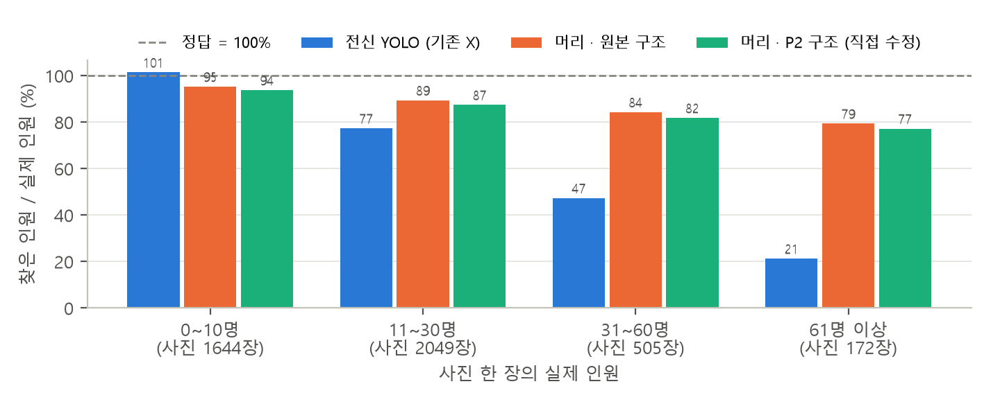

# CrowdFace — 밀집도 기반 인파 사고 조기 경보

강남대학교 컴퓨터비전 미니프로젝트 · 202104183 김현중, 202204201 김태섭

CCTV·휴대폰 영상에서 사람의 **머리**를 찾아 인원을 세고, 바닥 넓이로 나눠 **㎡당 인원**을 구한 뒤 위험 단계에 이르면 경보하는 시스템입니다.

## 동기

- 2022년 이태원 골목은 ㎡당 7.7~10.7명까지 밀집해 159명이 숨졌습니다(국과수 분석, 서울신문 2023-01-13).
- 서울시는 ㎡당 3·4·5명을 주의·경계·심각 기준으로 쓰지만(서울시 미디어허브 2023-10-25), 사람이 영상을 보며 세기는 어렵고 붐빌수록 몸이 가려져 더 셀 수 없습니다.

## 구조

| 단계 | 내용 | 구분 |
|---|---|---|
| 1. 입력 | 높은 곳에 고정한 CCTV·휴대폰 영상 | |
| 2. 사람 탐지 | COCO 사전학습 YOLO로 전신 박스 탐지 (코드 수정 없음) | 기존 기능 |
| 3. 머리 탐지 | 같은 YOLO 학습 코드로 CrowdHuman 머리 박스를 학습해 '머리' 클래스 추가 | 추가 기능 ① |
| 4. 밀도 계산 | 바닥 네 점으로 원근 변환 → 2m×2m 칸별 ㎡당 인원 | 추가 기능 ② |
| 5. 출력 | 칸별 색 표시 영상, 경보 단계·시각·인원 기록 | |

**경보 기준:** ㎡당 3명 이상 주의 · 4명 이상 경계 · 5명 이상 심각 (같은 단계가 5초 이어지면 경보)

**전신과 머리 연결 규칙:** 머리 박스 중심이 전신 박스 위쪽 1/3 안이면 같은 사람으로 묶고, 머리만 잡힌 사람(몸이 가려진 경우)도 한 명으로 셉니다.

## 결과: 전신 → 머리 탐지 (2026-11-12)

같은 Ultralytics YOLO11n 학습 코드에 **데이터(CrowdHuman 머리 라벨 직접 변환)·출력 클래스(80 → 1)·모델 구조(P2 탐지층 직접 추가)**를 바꿔 머리를 찾도록 직접 학습했습니다.
CrowdHuman 검증 사진 4,370장(실제 인원 85,093명)에서 비교한 결과입니다. 자세한 내용은 [보고서 PDF](results/head_detection_report.pdf).

| 모델 | 머리 mAP50 | mAP50-95 | 인원 오차 (MAE) | 찾은 비율 | 61명 이상 사진 | ms/장 |
|---|---|---|---|---|---|---|
| 전신 YOLO (기존 기능) | - | - | 8.15 | 62.0% | 21.3% | 4.9 |
| 머리 · 원본 구조 | 0.812 | 0.504 | **3.10** | **87.0%** | **79.4%** | 4.8 |
| 머리 · P2 구조 (직접 수정) | **0.828** | **0.516** | 3.40 | 84.9% | 77.2% | 6.8 |



- **붐빌수록 전신은 못 센다**: 61명 이상 사진에서 전신은 21%, 머리는 79%를 셌습니다. 인원 오차 62% 감소.
- **P2 탐지층**: 박스 위치 정확도(mAP)는 올랐지만 16px 미만 작은 머리 재현율은 그대로(약 48%)였고 속도는 느려졌습니다. 인원 세기에는 원본 구조를 씁니다.
- 학습: RTX 4070, 입력 960, 30 epoch, 학습 15,000장 (base 1.3시간, P2 5.7시간).

## 데이터셋

| 이름 | 용도 | 링크 |
|---|---|---|
| CrowdHuman (Megvii, 2018) | 머리 탐지 학습. 학습 15,000 · 검증 4,370 · 시험 5,000장, 사람마다 머리·보이는 부분·전신 박스 | https://huggingface.co/datasets/sshao0516/CrowdHuman (공식 페이지: https://www.crowdhuman.org) |
| ShanghaiTech (Part A 482장 · Part B 716장) | 인원 세기 평가(머리 점 라벨) | https://www.kaggle.com/datasets/tthien/shanghaitech |
| MOT20 | 밀집 영상 시험(8개 영상, 13,410프레임) | https://motchallenge.net/data/MOT20/ |

> CrowdHuman은 비상업 연구·교육용이며 이미지 재배포가 금지되어 있어, 이 저장소에는 이미지를 올리지 않습니다.

## 참조 코드

| 저장소 | 쓰임 |
|---|---|
| [ultralytics/ultralytics](https://github.com/ultralytics/ultralytics) (AGPL-3.0) | **주 참조 코드.** 사람 탐지(`model.predict`)와 머리 학습(`model.train`) |
| [Owen718/Head-Detection-Yolov8](https://github.com/Owen718/Head-Detection-Yolov8) | CrowdHuman 머리 박스를 YOLO 라벨로 바꾸는 방식 참고 (라이선스 표기 없음, 참고만) |
| [cvlab-stonybrook/DM-Count](https://github.com/cvlab-stonybrook/DM-Count) (MIT) | 초밀집 장면 비교용 밀도 지도 |
| [TencentYoutuResearch/CrowdCounting-P2PNet](https://github.com/TencentYoutuResearch/CrowdCounting-P2PNet) | 발표 시연 사진의 머리 위치 예측 (머리 모델 학습 전 대체) |

## 평가 방법

- 머리 탐지: CrowdHuman 검증 사진 mAP, 전신 대비 인원 오차·머리 크기별 재현율 (`src/eval_heads.py`)
- 인원 세기: ShanghaiTech MAE
- 위험 단계: 직접 센 정답과 비교
- 속도: CPU 초당 프레임

## 일정

| 주차 | 내용 |
|---|---|
| 5주 (10/16) | 계획서 발표 (중간고사 전으로 당겨 진행, 별도 중간 발표 없음) |
| 6~9주 | 데이터 준비, 사람 탐지 |
| 10~13주 | 머리 학습, 밀도 계산·경보 |
| 14주 | 최종 시연·평가 |

## 출처

- Shao 외, *CrowdHuman: A Benchmark for Detecting Human in a Crowd*, arXiv:1805.00123
- Wang 외, *Distribution Matching for Crowd Counting*, NeurIPS 2020
- 서울신문 2023-01-13 (이태원 밀집도 국과수 분석), 서울시 미디어허브 2023-10-25 (인파 관리 기준)

## 폴더 구조

```
cv_project/
├─ src/
│  ├─ yolo_person.py         기존 기능: YOLO 전신 탐지 (기준선)
│  ├─ convert_crowdhuman.py  CrowdHuman .odgt → YOLO 머리 라벨 (직접 작성)
│  ├─ train_head.py          머리 학습 (base | p2)
│  ├─ eval_heads.py          전신 vs 머리 평가 → results/eval/
│  ├─ bench_speed.py         모델별 속도 측정
│  ├─ make_report.py         결과 보고서 PDF
│  ├─ check_setup.py         다른 PC에서 빠진 파일 점검
│  └─ crowd_*.py, compare.py 밀도 지도·머리 위치·경보 시연 (DM-Count, P2PNet)
├─ models/head_p2.yaml       직접 수정한 구조: YOLO11n + P2 탐지층, 1클래스
├─ notebooks/                Colab 학습 노트북 (예비용)
├─ results/                  보고서 PDF, 평가 수치, 그래프
├─ runs/head/*/results.csv   학습 곡선 기록
├─ data/  models/*.pt  refs/ (GitHub에 없음 → 아래 설치 참고)
└─ requirements.txt
```

## 설치 (Windows, cv_project 폴더에서)

```
py -3.13 -m venv .venv
.venv\Scripts\activate
python -m pip install -r requirements.txt
git clone https://github.com/cvlab-stonybrook/DM-Count refs/DM-Count
git clone https://github.com/TencentYoutuResearch/CrowdCounting-P2PNet refs/CrowdCounting-P2PNet
```

빠진 파일(가중치·데이터·참조 저장소)은 `python src\check_setup.py`로 점검하고, 받는 방법은 [CLAUDE.md](CLAUDE.md) 8절에 있습니다.
학습한 머리 가중치(`models/head_*.pt`)와 CrowdHuman 데이터는 용량·라이선스 때문에 저장소에 없습니다.

`models/yolo11n.pt`는 처음 한 번 `python -c "from ultralytics import YOLO; YOLO('yolo11n.pt')"`로 받은 뒤 models 폴더로 옮깁니다.

## 실행

```
python src\yolo_person.py   data\crowd.jpg results\yolo.jpg 1920  # 기존 기능: YOLO 전신 탐지만 (기준선)
python src\crowd_density.py data\crowd.jpg results\density.jpg
python src\crowd_result.py  data\crowd.jpg results\result.jpg      # 출력되는 slope, horizon 값을 기록
python src\crowd_heads.py   data\crowd.jpg results\heads.jpg  <slope> <horizon>
python src\crowd_final.py   data\crowd.jpg results\final.jpg  <slope> <horizon>
python src\compare.py                                              # YOLO vs DM-Count 비교 → results\cmp_*.jpg
```

머리 탐지 학습·평가 (CrowdHuman을 `data/crowdhuman/`에 받은 뒤):

```
python src\convert_crowdhuman.py data\crowdhuman\annotation_train.odgt data\crowdhuman\Images train
python src\convert_crowdhuman.py data\crowdhuman\annotation_val.odgt   data\crowdhuman\Images val
python src\train_head.py base 30 960 16     # 원본 구조 → models\head_base.pt
python src\train_head.py p2   30 960 8      # P2 구조   → models\head_p2.pt
python src\eval_heads.py                    # 전신 vs 머리 → results\eval\summary.json
python src\bench_speed.py
python src\make_report.py                   # → results\head_detection_report.pdf
```
