# YOLO11 모델 구조, 순서대로 쉽게

> 기존 기능 X(COCO로 학습된 `yolo11n.pt`로 사람 찾기)가 사진 한 장을 어떻게 처리하는지 **처음부터 끝까지 순서대로** 따라간다.
> 그림은 전부 `1.png`(거리 군중 사진)를 이 PC에서 모델에 실제로 넣고 꺼낸 결과다. 입력 크기는 640×480.

> **먼저 이 세 줄만 기억하기**
>
> 1. **backbone**: 사진을 반씩 줄여 가며 특징을 뽑는다. 줄일수록 "이게 사람이다"는 잘 알지만 위치는 거칠어진다.
> 2. **넥**: 작은 지도를 키워서 큰 지도와 붙인다 → 위치도 세밀하고 뜻도 아는 지도 3장(P3·P4·P5).
> 3. **Detect**: 그 지도의 칸마다 "사람이 있나, 박스는 어디까지인가"를 답한다. **nc** = 답할 종류 수 (COCO 80, 우리 머리 모델 1).
>
> 우리 프로젝트: **1·2는 COCO에서 배운 그대로 물려받고, 3의 nc만 1로 바꿔 머리를 다시 가르쳤다.**

**이 문서의 순서**

1. 모델은 세 부분으로 되어 있다 — backbone, head, 그리고 nc
2. nc: 몇 종류를 찾을까
3. backbone: 사진을 줄이면서 특징 찾기
4. head ①: 넥 — 키우고 이어 붙이기
5. head ②: Detect — 칸마다 답하기
6. 입력을 키우면 어떻게 되나
7. 한 장으로 정리 + 우리 프로젝트

---

## 1. 모델은 세 부분으로 되어 있다

<div class="fig">
<svg viewBox="0 0 1000 220" width="100%" xmlns="http://www.w3.org/2000/svg" font-family="Malgun Gothic" font-size="14">
<defs><marker id="m" viewBox="0 0 10 10" refX="9" refY="5" markerWidth="8" markerHeight="8" orient="auto"><path d="M0,0 L10,5 L0,10 z" fill="#555"/></marker></defs>
<rect x="10" y="60" width="130" height="90" rx="10" fill="#f4f4f2" stroke="#888" stroke-width="2"/>
<text x="75" y="100" text-anchor="middle" font-weight="700">사진</text><text x="75" y="124" text-anchor="middle" font-size="12">640×480</text>
<line x1="140" y1="105" x2="190" y2="105" stroke="#555" stroke-width="2.5" marker-end="url(#m)"/>
<rect x="195" y="40" width="230" height="130" rx="10" fill="#e8f1fc" stroke="#2a78d6" stroke-width="2.5"/>
<text x="310" y="80" text-anchor="middle" font-weight="700" fill="#1d4f8f" font-size="16">① backbone</text>
<text x="310" y="106" text-anchor="middle" font-size="13">사진을 줄이면서</text><text x="310" y="126" text-anchor="middle" font-size="13">특징을 찾는다</text>
<text x="310" y="152" text-anchor="middle" font-size="11" fill="#555">yaml 0~10번 층</text>
<line x1="425" y1="105" x2="475" y2="105" stroke="#555" stroke-width="2.5" marker-end="url(#m)"/>
<rect x="480" y="20" width="390" height="170" rx="10" fill="#fff" stroke="#999" stroke-width="1.5" stroke-dasharray="6 4"/>
<text x="675" y="42" text-anchor="middle" font-weight="700" font-size="15">② head  (yaml 11~23번)</text>
<rect x="495" y="55" width="175" height="120" rx="10" fill="#fdeee7" stroke="#eb6834" stroke-width="2.5"/>
<text x="582" y="90" text-anchor="middle" font-weight="700" fill="#b4501f">넥 (11~22번)</text>
<text x="582" y="116" text-anchor="middle" font-size="13">작은 지도를 키워서</text><text x="582" y="136" text-anchor="middle" font-size="13">큰 지도와 이어 붙인다</text>
<line x1="670" y1="115" x2="690" y2="115" stroke="#555" stroke-width="2.5" marker-end="url(#m)"/>
<rect x="695" y="55" width="160" height="120" rx="10" fill="#e6f6ef" stroke="#1baf7a" stroke-width="2.5"/>
<text x="775" y="90" text-anchor="middle" font-weight="700" fill="#14895f">Detect (23번)</text>
<text x="775" y="116" text-anchor="middle" font-size="13">칸마다</text><text x="775" y="136" text-anchor="middle" font-size="13">"뭐가 어디 있나" 답</text>
<text x="775" y="160" text-anchor="middle" font-size="12" fill="#14895f" font-weight="700">← nc = 답의 종류 수</text>
<line x1="870" y1="105" x2="900" y2="105" stroke="#555" stroke-width="2.5" marker-end="url(#m)"/>
<rect x="905" y="60" width="85" height="90" rx="10" fill="#f4f4f2" stroke="#888" stroke-width="2"/>
<text x="947" y="100" text-anchor="middle" font-weight="700">사람</text><text x="947" y="124" text-anchor="middle" font-size="12">7명</text>
</svg>
<p class="cap">그림 1. YOLO11은 크게 backbone과 head 두 덩어리이고, head 안에 넥과 Detect가 있다. nc는 Detect가 몇 종류로 답할지 정하는 숫자다.</p>
</div>

모델 설계도 `yolo11.yaml`도 정확히 이 순서로 적혀 있다.

```yaml
#@key ① nc — 몇 종류를 찾을까 (2절)
nc: 80

#@dim scales — 모델 크기 (우리는 가장 작은 n)
scales:
  n: [0.50, 0.25, 1024]

#@key ② backbone — 사진을 줄이면서 특징 찾기 (3절)
backbone:
  - [-1, 1, Conv, [64, 3, 2]]   # 0번 층
  # … 1~10번 층

#@key ③ head — 넥(키우고 이어 붙이기, 4절) + Detect(답하기, 5절)
head:
  - [-1, 1, nn.Upsample, [None, 2, "nearest"]]   # 11번: 키우기
  - [[-1, 6], 1, Concat, [1]]                    # 12번: 이어 붙이기
  # … 13~22번
  - [[16, 19, 22], 1, Detect, [nc]]              # 23번: 답하기
```

### yaml 한 줄 읽는 법

```yaml
#@key [어디서 받나, 몇 번 반복, 층 종류, 설정]
- [-1, 1, Conv, [64, 3, 2]]
```

| 칸 | 값 | 뜻 |
|---|---|---|
| 어디서 받나 | `-1` | 바로 앞 층의 출력. `[-1, 6]`이면 바로 앞 층 + 6번 층 둘 다 |
| 몇 번 반복 | `1` | 이 층을 몇 번 (× 깊이 배수 0.5) |
| 층 종류 | `Conv` | 합성곱 |
| 설정 | `[64, 3, 2]` | 층 종류마다 뜻이 다름 ↓ |

**Conv의 설정 `[64, 3, 2]`**

| 숫자 | 뜻 | 0번 층에서 |
|---|---|---|
| **64** | 출력 **판 장수**(채널) = 필터 개수 | 64 × 0.25(scales n) = 실제 **16장** |
| **3** | 필터 크기 **3×3** | |
| **2** | **보폭 2** → 가로세로 절반 | 480×640 → 240×320 |

> backbone의 Conv 층(0·1·3·5·7번)이 전부 `[?, 3, 2]`인 이유: 역할이 전부 "3×3 필터로 훑으면서 반으로 줄이기"라서. 몇 장 만들지(64·128·256·512·1024)만 다르다.

**C3k2의 설정 `[512, False]` / `[256, False, 0.25]`**

| 숫자 | 뜻 |
|---|---|
| 512 | 출력 판 장수 (× 0.25 = 실제 128장). 이어 붙인 판을 **섞어서 몇 장으로 정리할지** |
| False / True | 안쪽 블록 종류 (False = Bottleneck, True = C3k) |
| 0.25 (있을 때) | 안쪽에서 판을 얼마나 줄여서 계산할지 비율 |

---

## 2. nc — 몇 종류를 찾을까

- **nc** = **n**umber of **c**lasses = 찾을 물체 **종류의 수**.
- COCO 모델은 사람, 자전거, 자동차, 개 … **80종류**를 배웠다. 그래서 `nc: 80`. 사람은 그중 **0번**이다.
- 모델은 칸마다 **80개 점수**를 낸다: "여기가 사람일 확률 0.83, 자전거일 확률 0.01, …"
- 우리 `yolo_person.py`의 `classes=[0]`은 "80개 중 0번(사람) 점수만 보겠다"는 뜻이다.

| | 기존 X (COCO) | 우리 머리 모델 Y |
|---|---|---|
| nc | 80 | **1** (head 하나) |
| 칸마다 내는 점수 | 80개 | 1개 |
| 바뀌는 곳 | — | 맨 마지막 Detect 층의 출력 수만 |

> nc는 모델의 **마지막 출구 크기**만 정한다. backbone과 넥은 nc와 상관없이 똑같다. 그래서 머리 모델은 COCO에서 배운 backbone·넥을 그대로 물려받을 수 있었다(전이학습).

---

## 3. backbone — 사진을 줄이면서 특징 찾기

"사진을 줄이면서 특징을 찾는다"를 네 단계로 나눠 보자.

### 3-1. 특징 찾기 = 작은 필터로 사진을 훑기 (합성곱)

backbone의 기본 동작은 **합성곱(Conv)** 이다. **3×3 크기의 작은 숫자 판(필터)** 을 사진 위에 올려놓고 한 칸씩 옮기면서, 겹친 9칸의 값을 곱해서 더한다. 필터 모양과 비슷한 무늬가 있는 곳에서 큰 값이 나온다.

아래는 이해를 돕기 위해 **손으로 만든 필터 두 개**로 1.png를 훑어 본 것이다.

<div class="fig">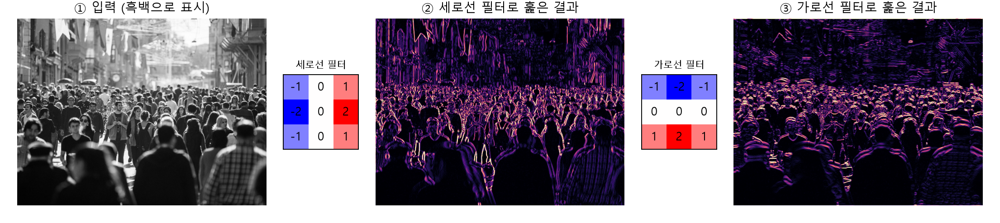<p class="cap">그림 2. 세로선 필터(왼쪽 −, 오른쪽 +)로 훑으면 사람의 세로 윤곽·건물 기둥이 밝게, 가로선 필터로 훑으면 어깨·머리 위쪽 같은 가로 경계가 밝게 나온다. 결과 사진 한 장 = "그 무늬가 어디 있는지 표시한 지도" = <b>특징 지도</b>.</p></div>

- 필터 숫자는 사람이 정하지 않는다. **학습하면서 모델이 스스로 정한다.** COCO 사진 수십만 장으로 학습한 결과가 `yolo11n.pt` 안에 들어 있다.
- YOLO의 Conv는 이 계산 뒤에 값을 고르게 맞추고(BatchNorm) 약한 값을 줄이는(SiLU) 처리를 한 번 더 한다.

### 3-2. 필터를 여러 개 쓰면 → 판이 여러 장 (채널)

필터 하나는 무늬 하나만 찾는다. 그래서 한 층에서 **필터를 여러 개** 쓴다. 필터마다 결과 판이 한 장씩 나오니까, 출력은 **판 여러 장을 겹친 묶음**이 된다. 이 장수를 **채널**이라고 부른다.

<div class="fig">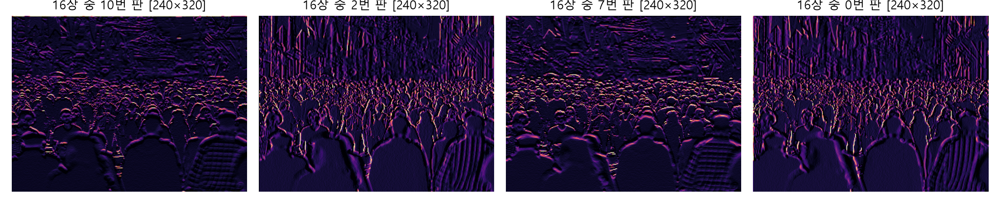<p class="cap">그림 3. 실제 0번 층(필터 16개)이 1.png에서 만든 16장 중 4장. 장마다 반응하는 무늬가 다르다 — 어떤 판은 윤곽선, 어떤 판은 밝은 부분, 어떤 판은 특정 방향 경계에 반응한다. 이 필터들은 모델이 COCO로 학습하며 스스로 만든 것이다.</p></div>

> 그래서 층의 출력 크기를 **[채널, 높이, 너비]** 로 적는다. 0번 층 출력 = [16, 240, 320] = 240×320 크기 판 16장.

### 3-3. 줄이기 = 필터를 두 칸씩 건너뛰며 훑기 (보폭 2)

필터를 한 칸씩 옮기면 결과 크기가 그대로지만, **두 칸씩 건너뛰면 결과가 가로세로 절반**이 된다. 이게 "보폭(stride) 2"다. yaml의 `Conv, [64, 3, 2]`에서 마지막 `2`가 이것이다.

<div class="fig">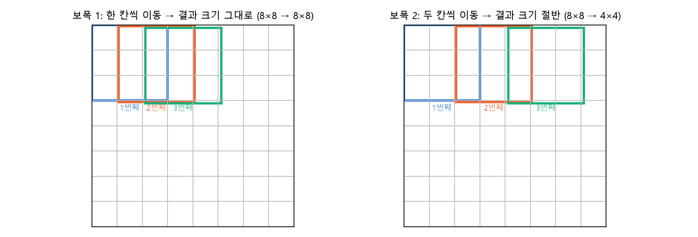<p class="cap">그림 4. 같은 3×3 필터라도 보폭 1이면 크기 그대로, 보폭 2면 절반. 특징을 찾는 일과 줄이는 일을 한 번에 한다.</p></div>

### 3-4. 이걸 반복하면 — 점점 작아지고, 판은 많아진다

backbone은 "**보폭 2 Conv로 절반 줄이기 → C3k2로 같은 크기에서 한 번 더 다듬기**"를 네 번 반복한다.

<div class="fig">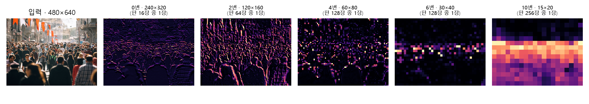<p class="cap">그림 5. 실제 층 출력(각 층의 판 중 1장). 처음(0번)엔 사진 윤곽이 그대로 보이지만, 줄어들수록 한 칸이 넓은 영역을 대표하고 "사람이 몰려 있는 줄" 같은 큰 정보만 남는다.</p></div>

| 단계 | 층 | 크기 (높이×너비) | 판 장수 | 칸 하나가 원본에서 맡는 넓이 |
|---|---|---|---|---|
| 입력 | — | 480×640 | 3 (빨·초·파) | 1×1 |
| 1/2 | 0번 | 240×320 | 16 | 2×2 |
| 1/4 (P2) | 1~2번 | 120×160 | 64 | 4×4 |
| **1/8 (P3)** | 3~4번 | **60×80** | 128 | **8×8** |
| **1/16 (P4)** | 5~6번 | **30×40** | 128 | **16×16** |
| **1/32 (P5)** | 7~10번 | **15×20** | 256 | **32×32** |

- **크기는 줄고 판 장수는 늘어난다.** 위치는 덜 세밀해지는 대신, "여기 무엇이 있나"에 대한 정보를 더 많은 판에 담는다.
- 끝의 9번(SPPF)은 넓은 범위를 한꺼번에 보고, 10번(C2PSA)은 중요한 위치에 집중하는 층이다. 둘 다 크기는 그대로다.
- **P2~P5는 줄어든 단계의 이름**이다. P 뒤 숫자만큼 2를 곱한 배율로 줄었다 (P3 = 2³ = 1/8).
- 원본 yaml 주석도 **크기를 줄이는 Conv 층**에 P 번호를 붙인다: `0-P1/2`, `1-P2/4`, `3-P3/8`, `5-P4/16`, `7-P5/32`. 즉 **1번 층 출력이 P2(1/4)** 이고, 바로 뒤 2번 C3k2도 같은 1/4 크기다.
- **기본 YOLO11은 P2를 만들기만 하고 탐지에는 안 쓴다** (Detect는 P3·P4·P5만 받음). 우리 P2 실험은 이 1/4 단계에서 다듬어진 2번 층 출력을 넥으로 끌어와 네 번째 지도로 쓴 것이다.

### 3-5. 왜 줄이나 — 멀리서 봐야 전체가 보인다

<div class="fig">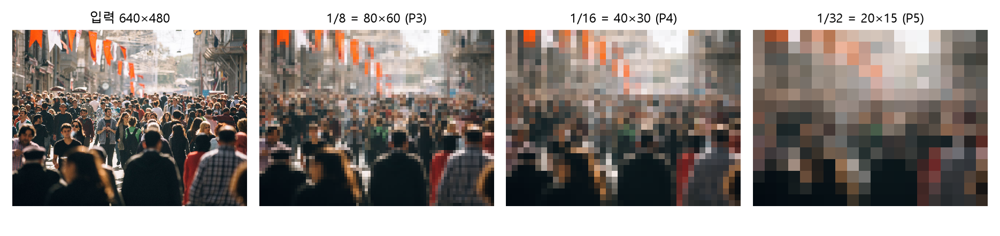<p class="cap">그림 6. 사진을 각 단계 크기로 줄여 본 비유. 가까이(큰 지도)서는 머리카락까지 보이지만 "이게 사람이다"를 판단하려면 넓은 범위를 봐야 한다. 줄일수록 한 칸이 넓은 영역을 보게 되어 큰 모양을 알아보기 쉽지만, 뒤쪽 작은 사람은 뭉개진다.</p></div>

<div class="fig">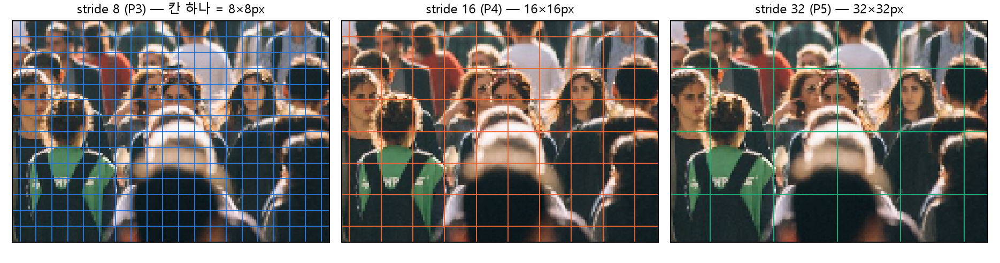<p class="cap">그림 7. 같은 부분에 각 단계의 칸 간격을 그린 것. 1/8(P3)은 작은 머리에도 칸이 여러 개, 1/32(P5)는 칸 하나에 사람 여러 명이 들어간다.</p></div>

### 3-6. 가우시안 필터랑 비슷해 보이는데? — 필터링의 목적

맞다. **YOLO의 합성곱은 수업에서 배운 가우시안·소벨 필터와 똑같은 계산**이다 (작은 숫자 판을 올려놓고 곱해서 더하기). 다른 점은 **숫자를 누가 정하나**와 **무엇을 하려고 쓰나**다.

<div class="fig">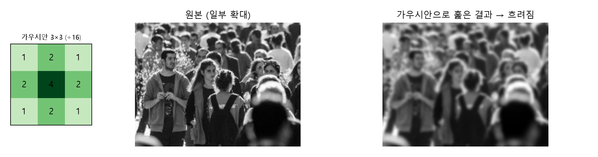<p class="cap">그림 G1. 가우시안 필터(가운데 4, 주변 2·1)는 이웃을 가중 평균해서 사진을 <b>흐리게</b> 한다. 목적은 잡음 제거·부드럽게 하기. 숫자는 사람이 정했고 늘 같다.</p></div>

<div class="fig">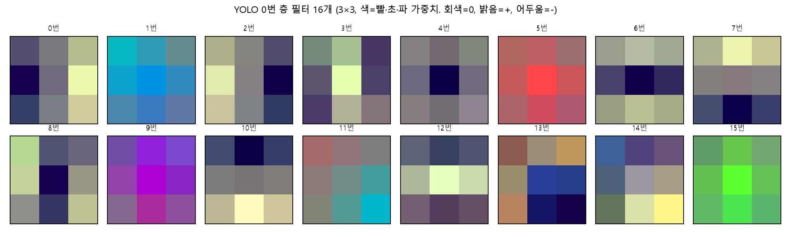<p class="cap">그림 G2. YOLO 0번 층이 COCO로 학습하며 <b>스스로 만든</b> 필터 16개. 사람이 정해 준 적이 없는데도 수업에서 배운 필터와 닮은 것들이 생겼다 — 0·2번은 왼쪽 어둡고 오른쪽 밝은 <b>세로 경계</b>(소벨과 비슷), 7·10번은 <b>가로 경계</b>, 4번은 가운데만 다른 <b>점</b>, 1·5·15번은 파랑·빨강·초록을 고르게 모으는 <b>색 평균</b>(가우시안과 비슷).</p></div>

| | 가우시안 · 소벨 (수업) | YOLO 합성곱 |
|---|---|---|
| 계산 | 이웃 칸 × 필터 숫자 → 더하기 | **같음** |
| 숫자는 누가 정하나 | 사람이 설계 (고정) | **학습으로 모델이 정함** |
| 개수 | 보통 1~2개 | 한 층에 16~256개 |
| 목적 | 흐리기(잡음 제거), 경계 찾기처럼 **사람이 정한 한 가지** | **사람을 찾는 데 도움이 되는 특징**이면 무엇이든 |
| 쌓으면 | 흐리기 두 번 = 더 흐린 것뿐 | 사이에 SiLU(비선형)가 있어서, 쌓을수록 선 → 모서리 → 얼굴·몸통 같은 **복잡한 모양**을 알아봄 |

**그럼 뒤쪽 층 그림이 흐릿하게 보이는 건?** 흐리게 하려는 게 아니라 **줄였기 때문**이다. 15×20 지도는 칸 하나가 원본 32×32px를 대표하니 커다란 덩어리로 보인다. 칸 하나에 담긴 건 "흐린 사진"이 아니라 "이 근처에 사람 모양이 있다" 같은 **판단 결과**다.

**정리**: 필터링의 목적은 사진을 보기 좋게 만드는 게 아니라, 사진을 **"사람을 찾기 좋은 숫자"로 바꾸는 것**이다. 처음 층은 가우시안·소벨처럼 단순한 무늬를, 깊은 층은 그 무늬들을 조합한 모양을 찾는다. 이 필터 숫자들이 바로 `yolo11n.pt`에 저장된 "학습한 가중치"이고, 전이학습으로 물려받은 것도 이것이다.

**정리**: 큰 지도는 **위치가 세밀하지만 뜻(이게 뭔지)을 잘 모르고**, 작은 지도는 **뜻은 잘 알지만 위치가 거칠다**. 이 약점을 메우는 게 다음 절의 넥이다.

---

## 4. head ① 넥 — 키우고 이어 붙이기

넥(neck, 목)은 backbone(몸통)과 Detect(머리) 사이에 있다. 하는 일은 **작은 지도의 "뜻"과 큰 지도의 "위치"를 합치는 것**이고, 도구는 두 개뿐이다: **키우기(Upsample)** 와 **이어 붙이기(Concat)**.

### 4-1. 키우기 (Upsample) — 칸을 그대로 복사해서 2배로

yaml `[-1, 1, nn.Upsample, [None, 2, "nearest"]]` = 바로 앞 지도를 **2배로 키운다**. 방법은 아주 단순하다: **칸 하나를 2×2로 그대로 복사**한다("nearest" = 가장 가까운 값 복사). 계산도 학습도 없다.

<div class="fig">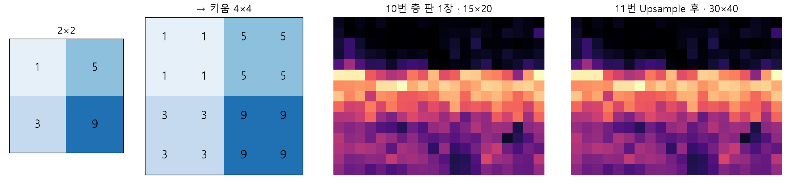<p class="cap">그림 8. 왼쪽: 2×2의 각 숫자가 2×2 덩어리로 복사돼 4×4가 된다. 오른쪽: 실제 10번 층 판(15×20)을 11번 Upsample이 30×40으로 키운 것 — 모양은 그대로이고 칸만 잘게 나뉘었다. 새로운 정보가 생기진 않는다.</p></div>

> 왜 키우나? **이어 붙이려면 가로세로 크기가 같아야 하기 때문**이다. 15×20인 10번 지도를 30×40인 6번 지도와 붙이려고 먼저 키운다.

### 4-2. 이어 붙이기 (Concat) — 판을 겹쳐 쌓기

yaml `[[-1, 6], 1, Concat, [1]]` = "**바로 앞(-1) 지도와 6번 층 지도를 받아서 이어 붙여라**". 크기가 같은 두 묶음의 **판을 한데 쌓는다**. 가로세로는 그대로, 판 장수만 더해진다.

<div class="fig">
<svg viewBox="0 0 1000 210" width="100%" xmlns="http://www.w3.org/2000/svg" font-family="Malgun Gothic" font-size="13">
<g fill="#e8f1fc" stroke="#2a78d6" stroke-width="1.5">
<rect x="60" y="40" width="120" height="90"/><rect x="66" y="46" width="120" height="90"/><rect x="72" y="52" width="120" height="90"/><rect x="78" y="58" width="120" height="90"/><rect x="84" y="64" width="120" height="90"/><rect x="90" y="70" width="120" height="90"/>
</g>
<text x="140" y="188" text-anchor="middle" font-weight="700">11번 (10번을 키운 것)</text><text x="140" y="205" text-anchor="middle" font-size="12">30×40 판 256장 — "뜻"</text>
<text x="265" y="115" text-anchor="middle" font-size="32" fill="#555">+</text>
<g fill="#fdeee7" stroke="#eb6834" stroke-width="1.5">
<rect x="320" y="64" width="120" height="90"/><rect x="326" y="70" width="120" height="90"/><rect x="332" y="76" width="120" height="90"/>
</g>
<text x="390" y="188" text-anchor="middle" font-weight="700">6번 (backbone에서 끌어옴)</text><text x="390" y="205" text-anchor="middle" font-size="12">30×40 판 128장 — "위치"</text>
<text x="515" y="115" text-anchor="middle" font-size="32" fill="#555">=</text>
<g stroke-width="1.5">
<rect x="580" y="22" width="120" height="90" fill="#e8f1fc" stroke="#2a78d6"/><rect x="586" y="28" width="120" height="90" fill="#e8f1fc" stroke="#2a78d6"/><rect x="592" y="34" width="120" height="90" fill="#e8f1fc" stroke="#2a78d6"/><rect x="598" y="40" width="120" height="90" fill="#e8f1fc" stroke="#2a78d6"/><rect x="604" y="46" width="120" height="90" fill="#e8f1fc" stroke="#2a78d6"/><rect x="610" y="52" width="120" height="90" fill="#e8f1fc" stroke="#2a78d6"/>
<rect x="616" y="58" width="120" height="90" fill="#fdeee7" stroke="#eb6834"/><rect x="622" y="64" width="120" height="90" fill="#fdeee7" stroke="#eb6834"/><rect x="628" y="70" width="120" height="90" fill="#fdeee7" stroke="#eb6834"/>
</g>
<text x="664" y="188" text-anchor="middle" font-weight="700">12번 Concat 결과</text><text x="664" y="205" text-anchor="middle" font-size="12">30×40 판 384장 — 둘 다</text>
<text x="790" y="60" font-size="13" fill="#333">· 가로세로 30×40은 그대로</text>
<text x="790" y="84" font-size="13" fill="#333">· 판만 쌓임: 256 + 128 = 384</text>
<text x="790" y="108" font-size="13" fill="#333">· 계산 없음, 쌓기만 함</text>
<text x="790" y="132" font-size="13" fill="#333">· 바로 뒤 13번 C3k2가</text>
<text x="790" y="152" font-size="13" fill="#333">  384장을 섞어 128장으로 정리</text>
</svg>
<p class="cap">그림 9. Concat = 같은 크기 지도의 판을 겹쳐 쌓기 (판 한 장을 상자 하나로 그렸고, 장수는 비율만 맞췄다). 이렇게 쌓인 판을 다음 층이 함께 보면서 "뜻"과 "위치"를 섞는다.</p></div>

**이어 붙이는 조건: 판 장수가 아니라 가로세로 크기가 같아야 한다**

| Concat | 붙이는 두 지도 | 판 장수 | 가로세로 |
|---|---|---|---|
| 12번 | 11번(10번을 키움) + 6번 | **256 + 128** = 384 (서로 다름) | 30×40 = 30×40 ✓ |
| 15번 | 14번(13번을 키움) + 4번 | 128 + 128 = 256 | 60×80 = 60×80 ✓ |
| 18번 | 17번(16번을 줄임) + 13번 | **64 + 128** = 192 (서로 다름) | 30×40 = 30×40 ✓ |
| 21번 | 20번(19번을 줄임) + 10번 | **128 + 256** = 384 (서로 다름) | 15×20 = 15×20 ✓ |

- 판 장수는 달라도 된다. 판을 쌓는 것이니 그냥 **더해진다**.
- 가로세로가 다르면 못 붙인다. 그래서 붙이기 전에 **키우기(×2)나 보폭 2 Conv(½)로 크기를 먼저 맞춘다.** 2배로 키우는 건 판 장수가 아니라 가로세로다.
- C3k2의 `512` 같은 숫자는 붙이는 조건과 상관없다. 붙인 다음 **섞어서 몇 장으로 정리할지**를 정한다.

**P3·P4·P5 세 장을 서로 합치는 게 아니다**

- 이어 붙이기는 늘 **같은 크기 두 장**끼리만 한다 (위 표 4번).
- 넥이 끝나면 16번(60×80), 19번(30×40), 22번(15×20)은 **따로따로** Detect로 가고, Detect도 지도마다 따로 답한다.
- 마지막에 세 지도의 칸 답을 **한 줄로 늘어놓아** 4,800 + 1,200 + 300 = 6,300칸 목록을 만든다. 이건 판 겹치기가 아니라 칸 목록을 뒤에 붙이는 것이다.

**"끌어다 쓴다"는 말의 뜻**: 6번 지도는 backbone을 지나간 지 한참 됐지만, 모델이 출력을 따로 **저장해 뒀다가** 12번에서 다시 꺼내 쓴다. yaml 주석의 "← 나중에 넥이 끌어다 씀"이 이것이다. 4번·6번·10번(그리고 넥 안의 13번)이 저장되는 지도다.

### 4-3. 넥 전체 순서 — 키우기·이어 붙이기를 반복

<div class="fig">
<svg viewBox="0 0 1000 570" width="100%" xmlns="http://www.w3.org/2000/svg" font-family="Malgun Gothic" font-size="13">
<defs>
<marker id="a" viewBox="0 0 10 10" refX="9" refY="5" markerWidth="7" markerHeight="7" orient="auto-start-reverse"><path d="M0,0 L10,5 L0,10 z" fill="#555"/></marker>
<marker id="ar" viewBox="0 0 10 10" refX="9" refY="5" markerWidth="7" markerHeight="7" orient="auto-start-reverse"><path d="M0,0 L10,5 L0,10 z" fill="#b3261e"/></marker>
</defs>
<text x="120" y="30" text-anchor="middle" font-weight="700" fill="#2a78d6">backbone</text>
<text x="120" y="47" text-anchor="middle" font-size="11" fill="#555">저장해 둔 지도</text>
<text x="390" y="30" text-anchor="middle" font-weight="700" fill="#c4521f">넥 ① 키우며 내려가기</text>
<text x="390" y="47" text-anchor="middle" font-size="11" fill="#555">"뜻"을 큰 지도에 전달</text>
<text x="670" y="30" text-anchor="middle" font-weight="700" fill="#c4521f">넥 ② 줄이며 올라가기</text>
<text x="670" y="47" text-anchor="middle" font-size="11" fill="#555">"위치"를 작은 지도에 전달</text>
<text x="910" y="30" text-anchor="middle" font-weight="700" fill="#14895f">Detect로</text>
<text x="910" y="47" text-anchor="middle" font-size="11" fill="#555">세 지도에서 답하기</text>
<rect x="30" y="60" width="180" height="80" rx="8" fill="#e8f1fc" stroke="#2a78d6" stroke-width="2"/>
<text x="120" y="88" text-anchor="middle" font-weight="700">10번 · 15×20</text><text x="120" y="108" text-anchor="middle">판 256장</text><text x="120" y="126" text-anchor="middle" font-size="11" fill="#555">뜻 가장 강함</text>
<rect x="30" y="200" width="180" height="80" rx="8" fill="#e8f1fc" stroke="#2a78d6" stroke-width="2"/>
<text x="120" y="228" text-anchor="middle" font-weight="700">6번 · 30×40</text><text x="120" y="248" text-anchor="middle">판 128장</text>
<rect x="30" y="340" width="180" height="80" rx="8" fill="#e8f1fc" stroke="#2a78d6" stroke-width="2"/>
<text x="120" y="368" text-anchor="middle" font-weight="700">4번 · 60×80</text><text x="120" y="388" text-anchor="middle">판 128장</text><text x="120" y="406" text-anchor="middle" font-size="11" fill="#555">위치 가장 세밀</text>
<rect x="30" y="475" width="180" height="62" rx="8" fill="#f4f4f2" stroke="#888" stroke-width="1.5"/>
<text x="120" y="500" text-anchor="middle" font-weight="700">사진 480×640</text><text x="120" y="520" text-anchor="middle" font-size="11" fill="#555">0~3번: 반씩 줄이기</text>
<line x1="120" y1="475" x2="120" y2="422" stroke="#555" stroke-width="2" marker-end="url(#a)"/>
<line x1="120" y1="340" x2="120" y2="282" stroke="#555" stroke-width="2" marker-end="url(#a)"/><text x="128" y="316" font-size="11" fill="#555">줄이기</text>
<line x1="120" y1="200" x2="120" y2="142" stroke="#555" stroke-width="2" marker-end="url(#a)"/><text x="128" y="176" font-size="11" fill="#555">줄이기</text>
<rect x="290" y="200" width="200" height="80" rx="8" fill="#fdeee7" stroke="#eb6834" stroke-width="2"/>
<text x="390" y="224" text-anchor="middle" font-size="12">11 키우기 → 12 이어 붙이기</text><text x="390" y="246" text-anchor="middle" font-weight="700">13번 · 30×40</text><text x="390" y="266" text-anchor="middle" font-size="11" fill="#555">판 128장</text>
<rect x="290" y="340" width="200" height="80" rx="8" fill="#fdeee7" stroke="#eb6834" stroke-width="2"/>
<text x="390" y="364" text-anchor="middle" font-size="12">14 키우기 → 15 이어 붙이기</text><text x="390" y="386" text-anchor="middle" font-weight="700">16번 · 60×80</text><text x="390" y="406" text-anchor="middle" font-size="11" fill="#2a78d6" font-weight="700">★ P3 (작은 사람)</text>
<polyline points="210,112 390,112 390,198" fill="none" stroke="#555" stroke-width="2" marker-end="url(#a)"/><text x="300" y="106" text-anchor="middle" font-size="11" fill="#555">11번 키우기 ×2</text>
<line x1="210" y1="240" x2="288" y2="240" stroke="#b3261e" stroke-width="2.2" stroke-dasharray="6 4" marker-end="url(#ar)"/><text x="249" y="232" text-anchor="middle" font-size="11" fill="#b3261e" font-weight="700">6번</text>
<line x1="390" y1="280" x2="390" y2="338" stroke="#555" stroke-width="2" marker-end="url(#a)"/><text x="398" y="314" font-size="11" fill="#555">14번 키우기 ×2</text>
<line x1="210" y1="380" x2="288" y2="380" stroke="#b3261e" stroke-width="2.2" stroke-dasharray="6 4" marker-end="url(#ar)"/><text x="249" y="372" text-anchor="middle" font-size="11" fill="#b3261e" font-weight="700">4번</text>
<rect x="570" y="60" width="200" height="80" rx="8" fill="#fdeee7" stroke="#eb6834" stroke-width="2"/>
<text x="670" y="84" text-anchor="middle" font-size="12">20 줄이기 → 21 이어 붙이기</text><text x="670" y="106" text-anchor="middle" font-weight="700">22번 · 15×20</text><text x="670" y="126" text-anchor="middle" font-size="11" fill="#1baf7a" font-weight="700">★ P5 (큰 사람)</text>
<rect x="570" y="200" width="200" height="80" rx="8" fill="#fdeee7" stroke="#eb6834" stroke-width="2"/>
<text x="670" y="224" text-anchor="middle" font-size="12">17 줄이기 → 18 이어 붙이기</text><text x="670" y="246" text-anchor="middle" font-weight="700">19번 · 30×40</text><text x="670" y="266" text-anchor="middle" font-size="11" fill="#eb6834" font-weight="700">★ P4 (중간 사람)</text>
<line x1="490" y1="380" x2="828" y2="380" stroke="#555" stroke-width="2" marker-end="url(#a)"/>
<line x1="670" y1="380" x2="670" y2="282" stroke="#555" stroke-width="2" marker-end="url(#a)"/><text x="678" y="330" font-size="11" fill="#555">17번 줄이기</text>
<line x1="490" y1="240" x2="568" y2="240" stroke="#b3261e" stroke-width="2.2" stroke-dasharray="6 4" marker-end="url(#ar)"/><text x="529" y="232" text-anchor="middle" font-size="11" fill="#b3261e" font-weight="700">13번</text>
<line x1="670" y1="200" x2="670" y2="142" stroke="#555" stroke-width="2" marker-end="url(#a)"/><text x="678" y="176" font-size="11" fill="#555">20번 줄이기</text>
<line x1="210" y1="76" x2="568" y2="76" stroke="#b3261e" stroke-width="2.2" stroke-dasharray="6 4" marker-end="url(#ar)"/><text x="480" y="70" text-anchor="middle" font-size="11" fill="#b3261e" font-weight="700">10번</text>
<line x1="770" y1="100" x2="828" y2="100" stroke="#555" stroke-width="2" marker-end="url(#a)"/>
<line x1="770" y1="240" x2="828" y2="240" stroke="#555" stroke-width="2" marker-end="url(#a)"/>
<rect x="830" y="60" width="160" height="80" rx="8" fill="#e6f6ef" stroke="#1baf7a" stroke-width="2"/>
<text x="910" y="94" text-anchor="middle" font-weight="700">P5 · 15×20</text><text x="910" y="116" text-anchor="middle">= 300칸</text>
<rect x="830" y="200" width="160" height="80" rx="8" fill="#e6f6ef" stroke="#1baf7a" stroke-width="2"/>
<text x="910" y="234" text-anchor="middle" font-weight="700">P4 · 30×40</text><text x="910" y="256" text-anchor="middle">= 1,200칸</text>
<rect x="830" y="340" width="160" height="80" rx="8" fill="#e6f6ef" stroke="#1baf7a" stroke-width="2"/>
<text x="910" y="374" text-anchor="middle" font-weight="700">P3 · 60×80</text><text x="910" y="396" text-anchor="middle">= 4,800칸</text>
<text x="910" y="455" text-anchor="middle" font-weight="700" fill="#14895f">합 6,300칸</text>
<line x1="300" y1="530" x2="340" y2="530" stroke="#b3261e" stroke-width="2.2" stroke-dasharray="6 4"/><text x="348" y="534" font-size="12" fill="#333">= 저장해 뒀다 끌어와서 이어 붙이는 지도</text>
<line x1="300" y1="552" x2="340" y2="552" stroke="#555" stroke-width="2"/><text x="348" y="556" font-size="12" fill="#333">= 순서대로 흘러가는 길 (줄이기 / 키우기)</text>
</svg>
<p class="cap">그림 10. 넥 전체. ① 10번(뜻)을 키워 6번과, 다시 키워 4번과 이어 붙이며 내려간다 → 16번(P3)은 위치가 세밀하면서 뜻도 안다. ② 16번을 다시 줄여 13번과, 또 줄여 10번과 이어 붙이며 올라간다 → 19번(P4), 22번(P5)에도 세밀한 위치 정보가 들어간다.</p></div>

| 순서 | 층 | 하는 일 | 결과 (판 장수, 크기) |
|---|---|---|---|
| 1 | 11 | 10번(256장, 15×20)을 **키우기** | 256장, 30×40 |
| 2 | 12 | + 6번(128장) **이어 붙이기** | 384장, 30×40 |
| 3 | 13 | C3k2로 섞어 정리 | 128장, 30×40 |
| 4 | 14 | **키우기** | 128장, 60×80 |
| 5 | 15 | + 4번(128장) **이어 붙이기** | 256장, 60×80 |
| 6 | 16 | 정리 → **P3 완성** | 64장, 60×80 |
| 7 | 17 | 보폭 2 Conv로 **줄이기** | 64장, 30×40 |
| 8 | 18 | + 13번(128장) **이어 붙이기** | 192장, 30×40 |
| 9 | 19 | 정리 → **P4 완성** | 128장, 30×40 |
| 10 | 20 | **줄이기** | 128장, 15×20 |
| 11 | 21 | + 10번(256장) **이어 붙이기** | 384장, 15×20 |
| 12 | 22 | 정리 → **P5 완성** | 256장, 15×20 |

### 4-4. 판 장수는 왜 늘었다 줄었다 하나

yaml 숫자를 보면 backbone은 64 → 1024로 **커지기만** 하고, head는 512 → 256으로 **작아졌다가** 다시 1024로 커진다. 규칙은 하나다: **가로세로가 작아지면 판을 늘리고, 커지면 판을 줄인다.** backbone과 head는 크기가 움직이는 방향이 달라서 숫자도 다르게 움직인다.

| 구간 | 층 | yaml 숫자 | 실제 판 장수 | 가로세로 |
|---|---|---|---|---|
| backbone (줄이기만) | 0 → 1 → 3 → 5 → 7 | 64 → 128 → 256 → 512 → 1024 | 16 → 32 → 64 → 128 → 256 | 240×320 → … → 15×20 |
| 넥 ① (키우기) | 13 → 16 | 512 → 256 | 128 → **64** | 30×40 → **60×80** |
| 넥 ② (줄이기) | 19 → 22 | 512 → 1024 | 128 → **256** | 30×40 → **15×20** |

같은 크기끼리 보면 backbone이든 head든 판 장수가 거의 같다 (30×40 → 128장, 15×20 → 256장). **판 장수는 그 지도의 크기를 따라간다.**

**왜 이런 규칙인가**

1. **계산량 맞추기**: 계산량 ≈ 칸 수 × 판 장수. 칸이 많은 큰 지도(60×80 = 4,800칸)에 판까지 많으면 너무 느리다. 큰 지도는 판을 적게, 작은 지도(15×20 = 300칸)는 판을 많이 둬서 층마다 계산량을 비슷하게 맞춘다.
2. **담을 정보의 종류**: 큰 지도는 선·경계처럼 단순한 특징이라 종류가 적어도 된다. 작은 지도는 얼굴·몸통·바퀴처럼 복잡한 특징을 구분해야 해서 판이 많이 필요하다.
3. **정보를 너무 잃지 않기**: 가로세로를 반으로 줄이면 칸이 1/4이 된다. 판을 2배로 늘려 담을 수 있는 양이 급격히 줄지 않게 한다.

### 4-5. 줄이기 · 키우기 · 이어 붙이기의 장점과 단점

| | 장점 | 단점 | 단점을 어떻게 메우나 |
|---|---|---|---|
| **줄이기** (보폭 2 Conv) | ① 칸 하나가 넓은 범위를 봐서 **큰 모양**(사람 전체)을 판단할 수 있다 ② 칸이 1/4로 줄어 **계산이 빠르다** ③ 위치가 조금 달라도 같은 판단 → 흔들림에 강하다 | **작은 물체 정보가 사라진다**, 위치가 거칠어진다 | 넥이 큰 지도(4·6번)를 다시 가져와 붙인다 |
| **키우기** (Upsample) | 계산·학습이 **없어서 빠르다**. 이어 붙일 크기를 맞춘다 | 칸을 복사할 뿐 **새 정보가 생기지 않는다** — 줄일 때 잃은 세부는 되살아나지 않는다 | 바로 뒤 Concat으로 세부가 남아 있는 backbone 지도를 붙인다 |
| **이어 붙이기** (Concat) | 두 지도의 정보를 **그대로 다 보존**한다. 어느 쪽을 얼마나 쓸지는 다음 층이 학습으로 정한다 (두 지도를 그냥 더하면 섞여 버려 구분이 안 된다) | 판 장수가 늘어 **메모리·계산이 는다** (256 + 128 = 384장) | 바로 뒤 C3k2가 384장을 128장으로 정리한다 |

**세 가지를 같이 쓰는 이유 — 한쪽만 쓰면 생기는 문제**

- **줄이지 않으면**: 칸 하나가 좁은 범위만 봐서 큰 사람을 하나로 알아보지 못하고, 640×480 그대로면 계산이 너무 많다.
- **줄이기만 하면**: 1.png에서 본 것처럼 작은 사람을 놓친다 (작은 사람 담당 P3도 점수 0.11).
- **그래서**: 줄여서 뜻을 얻고 → 키워서 → 줄이기 전 지도와 붙여 위치를 되찾는다. 이것이 넥의 "줄였다가 키워서 붙이기" 구조다.

**우리 실험과 연결 — 넥으로도 못 되찾는 것이 있다**

이어 붙이기로 되찾는 위치 정보는 **backbone 지도에 아직 남아 있는 것**뿐이다. 입력을 960으로 줄이는 단계에서 이미 몇 픽셀이 된 작은 머리는, 어느 지도에도 정보가 없어서 넥이 아무리 섞어도 되살아나지 않는다.

CrowdHuman 검증 4,370장, 16px 미만 머리의 재현율 (head_base 기준):

| 방법 | 신뢰도 0.25 (Ultralytics 기본) | 인원 세기 기준 (센 합 = 실제 합) |
|---|---|---|
| 보통 | 48.7% | 54.8% (기준 0.15) |
| P2 탐지층 추가 | 48.4% | 57.4% (기준 0.15) |
| 타일링 2×2 (입력 확대) | — | **63.4%** (기준 0.25) |

- **P2 실험**: 더 큰 지도(1/4)를 하나 더 붙였다. 기본 기준 0.25에서는 48.7% → 48.4%로 그대로, 인원 세기 기준에서는 54.8% → 57.4%로 **+2.6%p만** 올랐다.
- **타일링 실험**: 사진을 조각내 **입력 자체를 크게** 넣었더니 54.8% → 63.4%로 **+8.6%p** 올랐다.
- 주의: 두 값을 비교할 때는 **같은 열(같은 기준)끼리** 비교한다. "48.7 → 63.4"처럼 다른 기준을 섞으면 효과가 부풀려진다.
- → **작게 찍힌 머리에 한해서는**, 구조(넥·탐지층)를 바꾸는 것보다 입력을 키우는 것이 훨씬 효과가 크다. 처음 줄일 때 사라진 정보가 주원인이라는 뜻이다.
- 단, 이것이 머리를 놓치는 원인의 전부는 아니다.
    - HT21 시연 영상: 머리가 26~45px로 작지 않아 타일링 효과가 없었다. 놓친 원인은 **검은 뒤통수·검은 외투(모양)**.
    - JHU 초밀집 사진: 32px 이상 큰 머리도 **서로 겹칠 만큼 빽빽하면**(c<1) 재현율 45%로 떨어졌다.

---

## 5. head ② Detect — 칸마다 답하기

넥이 만든 세 지도(16·19·22번)의 **칸 하나하나**가 같은 질문에 답한다: **"내 칸 근처에 물체가 있나? 있으면 박스는 어디까지고, 무엇인가?"**

| 답의 종류 | 개수 | 설명 |
|---|---|---|
| 박스 | 4 | 칸 중심에서 왼·위·오른·아래 변까지 거리 |
| 종류별 점수 | **nc = 80** | 사람 0.83, 자전거 0.01, … |

칸이 4,800 + 1,200 + 300 = **6,300개**이니, 답은 6,300 × (4 + 80)개다.

<div class="fig">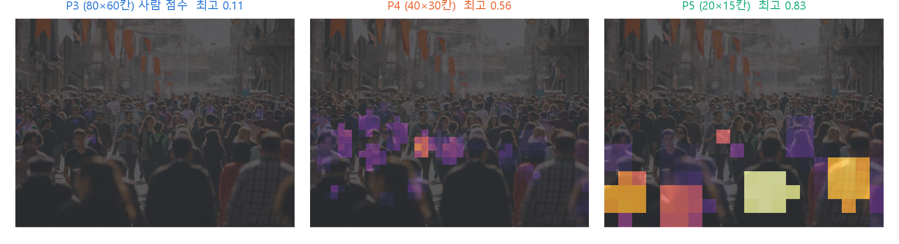<p class="cap">그림 11. 각 지도가 낸 "사람 점수"를 원본 위에 겹친 것 (밝을수록 높음). 큰 지도 P5는 앞쪽 큰 사람에 0.83, 중간 지도 P4는 중간 크기 사람에 0.56을 냈다. 작은 사람 담당 P3는 최고 0.11로 기준 0.25를 못 넘었다.</p></div>

마지막으로 **점수 0.25를 넘는 사람 칸**만 남기고(53개), 같은 사람을 가리키는 겹친 박스를 하나로 합치면(NMS) 최종 결과가 나온다.

<div class="fig">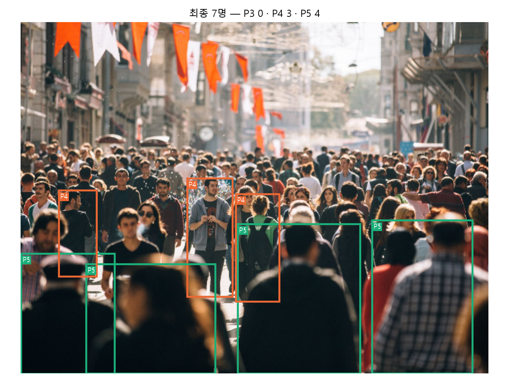<p class="cap">그림 12. 최종 7명. 박스 색 = 그 박스를 낸 지도 (주황 P4 3명, 초록 P5 4명). 작은 사람은 하나도 못 찾았다.</p></div>

---

## 6. 입력을 키우면 어떻게 되나

사진을 640이 아니라 **1920**으로 넣으면 모든 지도가 3배씩 커지고(칸 6,300 → 56,700개), 뒤쪽 사람도 칸 여러 개에 걸쳐 점수가 나온다.

<div class="fig">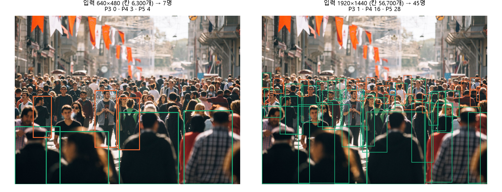<p class="cap">그림 13. 같은 사진, 입력 640 → 7명 / 입력 1920 → 45명. 대신 칸이 9배라 계산도 그만큼 느려진다.</p></div>

> 붐비는 사진에서 작은 사람·작은 머리를 놓치는 게 YOLO의 약점이다. 우리가 머리 모델에서 **입력을 960으로 키우고, 사진을 조각내 확대하는 타일링**을 시도한 이유가 이것이다.

---

## 7. 한 장으로 정리

| 이름 | yaml 위치 | 하는 일 | 1.png에서 |
|---|---|---|---|
| **nc** | 맨 위 `nc: 80` | 찾을 종류 수 = 칸마다 점수 몇 개 낼지 | 80 (사람 = 0번) |
| **backbone** | `backbone:` 0~10번 | 작은 필터로 훑어 특징 찾기 + 보폭 2로 반씩 줄이기 | 480×640 → 60×80 · 30×40 · 15×20 |
| **넥** | `head:` 11~22번 | 작은 지도를 **키워서**(Upsample) 큰 지도와 **이어 붙이기**(Concat), 다시 줄이며 이어 붙이기 | P3 · P4 · P5 지도 3장 |
| **Detect** | `head:` 23번 | 세 지도 칸마다 박스 4개 + 점수 nc개 | 6,300칸 → 사람 7명 |

**우리 프로젝트와 연결**

- **머리 모델 Y**: nc만 80 → 1로 바뀌었다. backbone과 넥은 COCO에서 배운 필터를 그대로 물려받았다(전이학습).
    - 정확히는: nc=1로 모델을 처음 만들면 Detect 점수 갈래(cv3) 중간 폭이 64가 된다(COCO는 80). 그런데 `load()`가 COCO 가중치를 넣을 때 cv3를 COCO 것(폭 80)으로 통째로 바꿔 끼우고 **마지막 1×1 층(80 → 1)만 새로 만든다**. 그래서 결과적으로 COCO와 다른 층은 마지막 1×1 하나뿐이다 (Ultralytics 8.4.208 기준, 학습 전체 코드 1절).
- **P2 실험**: backbone 2번 층(1/4, 120×160)도 넥에서 한 번 더 키우고 이어 붙여, Detect가 **네 번째 지도(P2, 칸 4×4px)** 에서도 답하게 한 것. 칸을 더 촘촘하게 해서 작은 머리를 잡으려 했지만, 입력을 줄이는 순간 작은 머리 정보가 이미 사라져 효과가 작았다(16px 미만 재현율 +2.6%p, 타일링은 +8.6%p).

**예상 질문**

| 질문 | 한 줄 답 |
|---|---|
| backbone이 뭔가요? | 작은 필터로 사진을 훑어 특징을 찾으면서, 반씩 줄여 가는 앞부분(0~10번). |
| 줄이면서 뭘 하나요? | 줄일 때마다 필터로 더 넓은 범위의 무늬를 찾는다. 처음엔 선, 나중엔 사람 모양 같은 큰 특징. |
| 넥은 왜 있나요? | 큰 지도는 위치가 세밀하지만 뜻을 모르고, 작은 지도는 뜻을 알지만 위치가 거칠다. 둘을 합친다. |
| Upsample은요? | 칸을 2×2로 복사해 2배로 키우기. 이어 붙일 크기를 맞추려고 한다. |
| Concat은요? | 같은 크기 지도의 판을 겹쳐 쌓기. 계산 없이 쌓기만 하고, 다음 층이 섞는다. |
| 이어 붙이려면 뭐가 같아야 하나요? | 가로세로 크기. 판 장수는 달라도 되고 더해진다. |
| P3·P4·P5를 합치나요? | 아니다. 따로 Detect로 가고, 마지막에 칸 답만 한 줄로 늘어놓는다. |
| `[64, 3, 2]`는요? | Conv의 [출력 판 장수, 필터 크기 3×3, 보폭 2(절반으로)]. |
| P2는 어디인가요? | 1번 층이 만든 1/4 크기 지도. 기본 YOLO11은 탐지에 안 쓴다. |
| 가우시안 필터와 뭐가 다른가요? | 계산은 같다. 숫자를 사람이 아니라 학습으로 정하고, 한 층에 수십 개를 써서 사람 찾기에 필요한 특징을 뽑는다. |
| 판 장수는 왜 바뀌나요? | 지도가 작아지면 늘리고 커지면 줄인다. 계산량을 맞추고, 작은 지도엔 복잡한 특징이 많이 필요해서. |
| 줄이기의 단점은요? | 작은 물체 정보가 사라진다. 넥이 큰 지도를 다시 붙여 메우지만, 처음부터 사라진 정보는 못 되찾는다 (P2 실험 +2.6%p vs 타일링 +8.6%p). |
| nc는요? | 찾을 종류 수. 마지막 Detect 출력 수만 정한다. 머리 모델은 1. |
